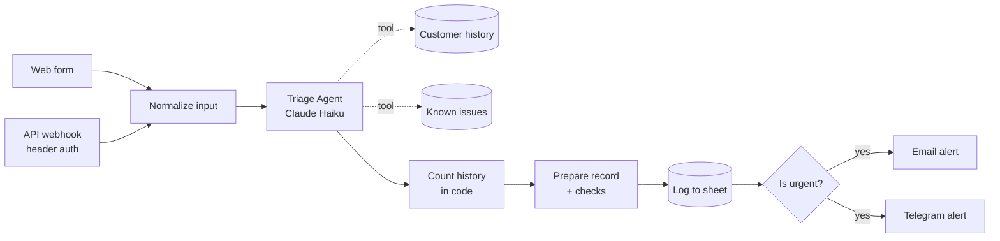

# AI Customer Inbox Assistant

An n8n workflow that triages customer complaints with an AI agent. It checks each customer's history and a list of known issues, decides how serious the problem is, logs everything to Google Sheets, and alerts the support team by email and Telegram with a draft reply ready to review.

Built with **n8n**, **Claude Haiku 5.5**, **Google Sheets**, **Gmail** and **Telegram**.

> 🎥 **Demo video:** _link coming soon_

---

## What it does

A customer reports a problem through a web form or an API call. Within about 10 seconds:

1. An **AI agent** reads the complaint, looks up the customer's previous complaints and checks whether it matches a known issue.
2. It decides the **severity** (critical, high, medium, low) and writes a **draft reply**, including the workaround when the issue is known.
3. The complaint is **logged** to a Google Sheet.
4. If it is urgent, the team gets an **email and a Telegram alert** with the draft reply, so they can respond in seconds.

A person always reviews and sends the reply. The AI never contacts the customer directly.

## How it works



| Step | What happens |
|---|---|
| **Two inputs** | A public web form, and a `POST` API endpoint protected by an API key header. Both are converted to the same shape first, so the rest of the workflow doesn't care where a complaint came from. |
| **Triage Agent** | Claude Haiku with two **read-only** tools and a limit of 5 steps. Returns structured JSON: `severity`, `known_issue`, `suggested_reply`. |
| **Prepare record** | Validates the agent's output in code (see Guardrails) and counts the customer's previous complaints. |
| **Alerts** | Critical, high and unclear complaints trigger an email and a Telegram message with the draft reply and a quality check result. |

## Guardrails

AI output is never trusted blindly. Each weak point found during testing got a control in code or in the prompt:

| Risk | Control |
|---|---|
| AI returns an unexpected severity ("High!!", "urgent", nothing) | Cleaned and checked against the allowed values in code. Anything else becomes `needs_review` and triggers an alert. |
| Vague complaints ("app not working") get a low severity | The agent replies `unclear`, which becomes `needs_review`, so a human looks at it. |
| AI miscounts the customer's previous complaints | Counting is done in code, not by the AI. |
| A failed lookup looks like "0 previous complaints" | Shown as `unknown` instead. |
| Draft replies invent actions ("escalated as a priority") or ask several questions | Few-shot examples, specific reply rules, and an automatic **Reply Check** that flags invented promises, extra questions, or a false "the team has been notified" on non-urgent complaints. |
| Agent changes data | Tools are read-only. A human sends every reply. |

## Error handling

| Failure | Behaviour |
|---|---|
| AI API down or failing | Retries 3 times, then continues with `needs_review` and alerts the team. No complaint is lost. |
| Google Sheets fails | Retries, then still sends the alert, marked **"NOT logged in the sheet"**. |
| Gmail fails | Retries, then continues so the **Telegram** alert still goes out. |
| Anything else fails | A separate **Error Alerts** workflow sends the details by email and Telegram. |

## Testing

### Fault-injection tests

Each safety net was tested by breaking the system on purpose:

| Test | Result |
|---|---|
| Invalid AI model (AI unavailable) | ✅ Retried, then `needs_review` + alert |
| Invalid spreadsheet ID | ✅ Alert sent with "NOT logged" warning |
| Expired Gmail login | ✅ Telegram alert still delivered |
| API call without the API key | ✅ Rejected (403) |
| API call with `GET` instead of `POST` | ✅ Rejected (404) |
| Empty complaint / missing fields | ✅ `needs_review`, name and email shown as `Unknown` |

### Reply quality

Draft replies were scored on a fixed set of 5 test complaints, with 4 checks each: at most one question · no invented actions or promises · workaround included when a known issue matches · under 120 words.

| Version | Score |
|---|---|
| Rules only | 17/20 |
| + 2 few-shot examples | 18/20 (vague complaints fixed) |
| + specific reply rules + Reply Check | Data-loss complaint fixed: 4/4 |

Notes on coverage: each test was run once, so results can vary between runs. The data-loss test was verified after the final prompt change; the other four were last verified one change earlier.

### Bugs found and fixed

1. **Backup alert never sent when Gmail failed.** n8n runs parallel branches one after another, so a failing email step stopped the workflow before Telegram ran. Fixed by letting the email step continue on failure, and confirmed with an expired Gmail login.
2. **AI miscounted repeat complaints** (said 10 when the tool returned 11). Fixed by counting in code.
3. **Failed lookups reported as "0 previous complaints".** Fixed by showing `unknown`.
4. **Vague complaints rated "low".** Fixed with an `unclear` rule that routes them to a human.
5. **Draft replies invented actions** ("escalated to our team as a priority") and asked several questions. Reduced with few-shot examples and specific rules; the Reply Check catches what slips through.

## Cost

Measured on a real run (repeat customer, 2 agent calls, about 6,200 input and 600 output tokens):

| Volume | Claude Haiku 5.5 | Claude Sonnet 5.5 (for comparison) |
|---|---|---|
| 1 complaint | ~$0.001 | ~$0.018 |
| 1,000 complaints / month | **~$1** | ~$18 |

Hosting is the main cost, not the AI.

## Setup

**Requirements:** n8n 2.45.4 (pinned), an Anthropic API key, a Google account, a Telegram bot.

1. **Google Sheet** with two tabs:
   - `Sheet1`: `Date`, `Name`, `Email`, `Complaint`, `Severity`, `Source` (further columns are added automatically)
   - `Known Issues`: `Issue`, `Keywords`, `Workaround`, `Status` (sample rows in `sample-data/known-issues.csv`)
2. **Import** `workflow/ai-customer-inbox-assistant.json` and `workflow/error-alerts.json` into n8n.
3. **Create credentials:** Anthropic, Google Sheets OAuth2, Gmail OAuth2, Telegram, and Header Auth (for the API key).
4. **Replace the placeholders:** `YOUR_SHEET_ID`, `YOUR_ALERT_EMAIL`, `YOUR_TELEGRAM_CHAT_ID`.
5. In the main workflow's settings, set **Error Alerts** as the error workflow, then publish both.

**API example:**

```bash
curl -X POST https://your-n8n-host/webhook/complaint \
  -H "Content-Type: application/json" \
  -H "X-API-Key: <your key>" \
  -d '{"name": "Ali", "email": "ali@example.com", "complaint": "Checkout crashes when I press Pay"}'
```

## Limitations and next steps

- **Automated evaluation:** run the test set automatically, several times per test, with Promptfoo instead of by hand.
- **Smaller tool output:** the Customer history tool returns every column, which makes repeat customers cost more. Returning only date, complaint and severity would cut tokens.
- **Hosting:** tested through a Cloudflare tunnel. A production setup needs a 24/7 server, a domain, backups, monitoring, and the Google app moved out of testing mode (testing-mode logins expire after 7 days).

---

**Author:** Mohd Saleh, QA Engineer · [LinkedIn](https://www.linkedin.com/in/mohd-saleh-913827194)
